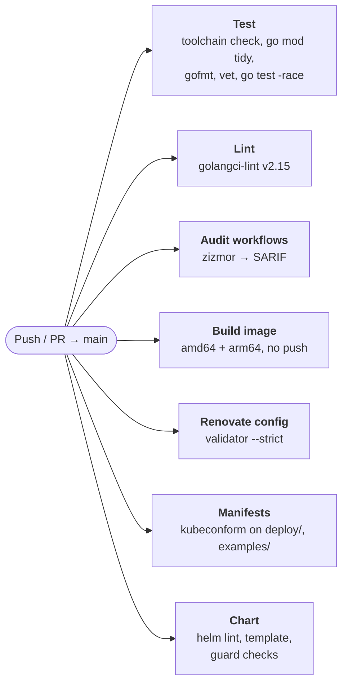
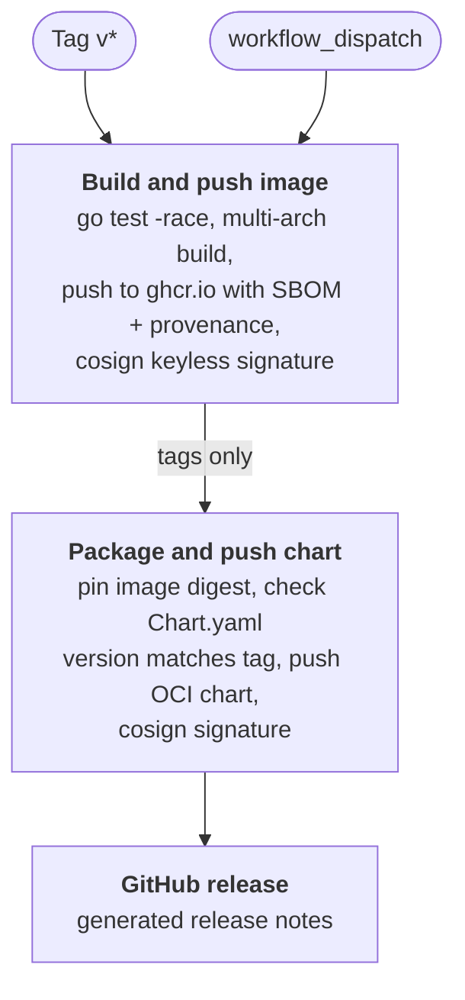

# Pipeline

Two workflows: [`ci.yaml`](workflows/ci.yaml) checks every change, and [`release.yaml`](workflows/release.yaml) publishes.

## CI

Runs on every push and pull request to `main`. All jobs run in parallel and are independent of each other. A newer push to the same ref cancels the run in progress.

## Release

Runs on a `v*` tag, or by hand through `workflow_dispatch`. The jobs run one after another. The chart pins the image by digest, and that digest only exists once the image has been pushed. The GitHub release comes last, so the release page only appears once everything it points to exists.

A manual dispatch only publishes the image, under the moving `:main` tag. A chart version and a GitHub release are only created for a `v*` tag.
